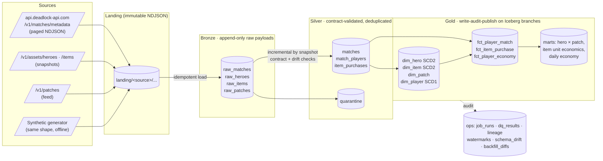
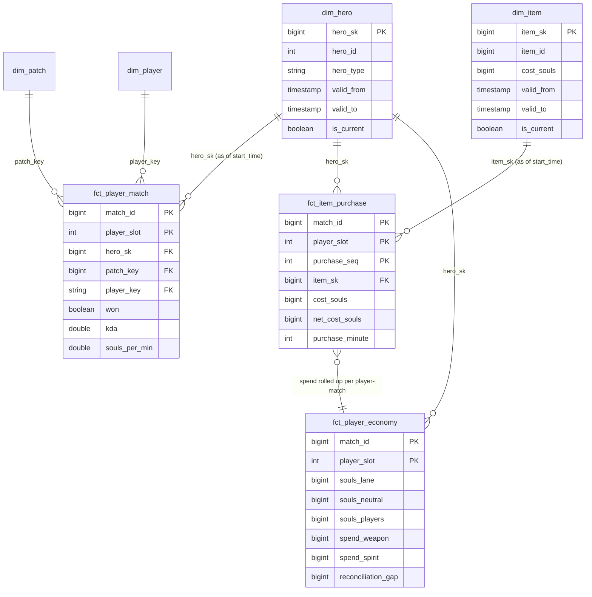

# Deadlock Lakehouse

**A production-style batch data platform in Scala, Apache Spark and Apache Iceberg, built on match data from Valve's *Deadlock*.**

It ingests match, hero, item and patch data from the community [Deadlock API](https://deadlock-api.com), lands it in an Iceberg lakehouse (bronze → silver → gold), and publishes a tested dimensional model. Every gold write is audited before anyone can read it. The centrepiece is **soul economics**, a unit-economics model of the game. Souls earned are revenue by source, items bought are costs by category, and SCD Type 2 dimensions value every purchase at the price that applied on the day the match was played.

I play a lot of Deadlock, and its economy turned out to be a good stand-in for the problems core-dataset teams deal with every day. Prices change from one release to the next. Producers add fields without notice and sometimes send bad records. A new product (here, a new hero) can show up in the facts before its reference data exists. Analysts need numbers they can reconcile.

---

## What this project demonstrates

| Data engineering responsibility | Where it lives |
|---|---|
| **Pipelines from varied sources** (paged REST API, reference-data snapshots, an RSS-style feed) | [`ingest/`](src/main/scala/com/ahmedmasood/deadlock/ingest): API client with backoff, `Retry-After` and watermarked pagination; one generic bronze loader for every source |
| **Source contracts and schema changes** | [`contracts/*.yaml`](contracts) are compiled into Spark schemas and validation rules. Bad records go to `silver.quarantine` with reasons. Undeclared fields are logged to `ops.schema_drift` |
| **Configurable pipelines and shared components** | A new source needs one YAML block in [`conf/pipeline.yaml`](conf/pipeline.yaml) and one contract file, with no new ingestion code |
| **Fact and dimension modelling, SCD Type 2** | [`gold/Scd2.scala`](src/main/scala/com/ahmedmasood/deadlock/gold/Scd2.scala): hash change detection, deterministic surrogate keys, out-of-order guard, a single atomic `MERGE`. `dim_player` is deliberately Type 1 |
| **Point-in-time correctness and historical data** | Facts join dimensions *as of match start*, so item costs are correct across repricing patches. Late-arriving dimensions get an unknown member and are repaired by a backfill |
| **Incremental processing** | Bronze → silver reads only the files appended since the last consumed **Iceberg snapshot**. Silver → gold uses a high-water mark. Late matches are picked up automatically |
| **Migrations and backfills** (dependency analysis, validation, cutover) | Versioned DDL migrations with checksums ([`MigrationRunner`](src/main/scala/com/ahmedmasood/deadlock/orchestration/MigrationRunner.scala)). `backfill` computes everything downstream from the job graph, rebuilds it in an **Iceberg branch**, diffs the branch against main, then fast-forwards main |
| **Tests, reconciliation and monitoring** | 40 ScalaTest cases, including an end-to-end run on a real Iceberg catalog. About 50 declarative DQ checks, including cross-layer reconciliations, are stored in `ops.dq_results`. Every run is recorded in `ops.job_runs` |
| **Write-audit-publish** | Gold is written to a branch, audited there, and published only if no blocking check fails ([`Publisher`](src/main/scala/com/ahmedmasood/deadlock/orchestration/Publisher.scala)) |
| **Lineage and governance** | Lineage is derived from the code (jobs declare their inputs and outputs) and recorded per run with snapshot ids. PII fields are flagged in contracts, and Steam ids are salted and hashed before gold |
| **Performance and cost** | Broadcast point-in-time joins, AQE, hidden partitioning, write ordering, partition-pruned deletes, compaction, snapshot expiry, and a reproducible [join-skew experiment](src/main/scala/com/ahmedmasood/deadlock/perf/SkewLab.scala). See [`docs/performance.md`](docs/performance.md) |
| **Orchestration and on-call** | Airflow DAGs for the daily run and for chunked, reviewable backfills ([`airflow/dags`](airflow/dags)), plus a [runbook](docs/runbook.md) |
| **SQL transformation layer** | The marts are plain SQL files run by a small dbt-style runner, which rebuilds only the partitions a run touched |

---

## Architecture



**Why each layer exists**
- **Landing** keeps the files exactly as fetched, so any load can be replayed.
- **Bronze** stores raw JSON as text. A producer schema change can never break ingestion, and history can always be re-parsed.
- **Silver** applies the contract: parse, validate, quarantine, deduplicate, and conform types. It is still at source grain.
- **Gold** is the dimensional model consumers query. It only changes through an audited publish.

## Data model



Grain, keys and every metric definition are documented in [`docs/data-model.md`](docs/data-model.md).

---

## Quickstart

Requirements: **JDK 17** and **sbt 1.10**. Spark and Iceberg are pulled in by sbt, and nothing else needs installing. Everything runs locally against an Iceberg catalog in `./lakehouse/`.

```bash
sbt test                                  # 40 tests, incl. an end-to-end run on a real Iceberg catalog
sbt "run demo"                            # scripted 30-day season: 3 incremental runs, a late dimension, a backfill
sbt "run sql \"SELECT * FROM lake.gold.mart_item_unit_economics ORDER BY lift_per_1k_souls DESC LIMIT 10\""
```

Day-to-day commands (`sbt "run <command>"`, or `spark-submit --class com.ahmedmasood.deadlock.Main deadlock-lakehouse.jar <command>`):

| Command | What it does |
|---|---|
| `generate --from 2026-10-01 --to 2026-10-30` | Write synthetic landing files (API-shaped, with planted problems) |
| `extract [--source matches]` | Pull live data from api.deadlock-api.com into landing |
| `daily [--api]` | Incremental run: landing → bronze → silver → gold (write-audit-publish) |
| `backfill --from D --to D --start-at gold.dim_item [--dry-run] [--no-publish]` | Rebuild a window and everything downstream in a branch, diff it, then cut over |
| `publish --branch backfill_<run_id>` | Cut over a branch that was audited and reviewed |
| `maintenance` | Compaction, manifest rewrite, snapshot expiry, orphan cleanup |
| `lineage` | Print the job/table graph as Mermaid ([output](docs/lineage.md)) |
| `skew-lab` | Run the join-skew experiment |

`sbt assembly` builds `target/scala-2.12/deadlock-lakehouse.jar` for `spark-submit` (Spark is `provided`).

### What the demo shows

```
1. Days 1-20 land, first daily run          -> SCD2: 42 items repriced on day 10 (tier 1: 500 -> 800 souls)
2. Day 21: patch 3 ships a new hero (Holliday), but the hero feed is a day behind
                                             -> 146 fact rows get the unknown member; DQ warns (published, not blocked)
3. Days 22-30 land with the new hero snapshot -> dim_hero gains Holliday; Abrams' rework opens a new version
4. backfill --start-at gold.dim_hero for day 21
     plan: dim_hero -> fct_player_match -> fct_item_purchase -> fct_player_economy -> marts
     diff: unknown_hero_rows 146 -> 0, row counts and souls unchanged -> fast-forward main
5. Quarantine by reason (bad enum, impossible duration, malformed JSON), schema drift
   (rewards_eligible, players[].hero_xp), DQ history, job runs
6. Marts: Abrams goes from ~38% to ~56% win rate after his rework, with 95% Wilson intervals;
   item lift per 1,000 souls; the daily soul revenue mix with its reconciliation gap
7. Time travel over the fact table's snapshots
```

Sample output is in [`docs/sample-output.md`](docs/sample-output.md).

---

## Repository layout

```
conf/pipeline.yaml              sources, catalog, tuning (onboarding a source = config + contract)
contracts/*.yaml                source contracts (schema, rules, PII, evolution policy)
src/main/resources/sql/
  migrations/V00N__*.sql        versioned DDL (Flyway-style, checksummed)
  marts/*.sql                   business marts in SQL
src/main/scala/com/ahmedmasood/deadlock/
  core/                         config, Spark session, job framework, ops store, shared model logic
  contracts/                    contract model, validator (higher-order functions), schema drift
  ingest/                       API client, landing zone, bronze loader, synthetic generator
  iceberg/                      branches, fast-forward, incremental reads, maintenance procedures
  silver/                       bronze -> silver (contract, quarantine, dedup, idempotent writes)
  gold/                         SCD2 engine, dimensions, facts, marts runner
  quality/                      check library and table expectations
  orchestration/                dependency graph, WAP publisher, daily pipeline, backfill, demo
  maintenance/  perf/           table hygiene; join-skew experiment
src/test/scala/                 unit + integration tests (ScalaTest)
airflow/dags/                   daily DAG and backfill DAG (Airflow 3)
docs/                           design doc, data model, runbook, performance notes, ADRs
```

## Design decisions

The full reasoning is in [`docs/design.md`](docs/design.md), with short records in [`docs/adr/`](docs/adr):

1. [Iceberg as the table format](docs/adr/0001-iceberg.md): branches for WAP and backfills, snapshot-based incremental reads, hidden partitioning, and engine neutrality.
2. [Raw payloads in bronze](docs/adr/0002-raw-payload-bronze.md): ingestion never breaks on schema change, and history can always be re-parsed.
3. [SCD2 with point-in-time joins and deterministic keys](docs/adr/0003-scd2-point-in-time.md)
4. [Write-audit-publish on branches](docs/adr/0004-write-audit-publish.md): bad data never reaches readers, and the failed branch is kept for debugging.
5. [Two incremental strategies](docs/adr/0005-incremental-strategies.md): snapshot diffs for append-only data, high-water marks for merged data.

## Limitations and next steps

- **Publish is atomic per table, not across tables.** Ordering (dimensions, then facts, then marts) prevents dangling keys. A REST catalog with multi-table commits (for example Polaris or Nessie) would close the gap.
- **The local Hadoop catalog is for development.** Production would use a REST/Glue/Hive catalog on S3 with `S3FileIO`, which is a config change in `pipeline.yaml`.
- **Item lift is correlational.** Late, expensive items are bought by players who are already ahead. Next: control for net worth at purchase time, or compare matched cohorts.
- **Out-of-order dimension snapshots are skipped, not merged into history.** A full rebuild (`backfill` from the dimension) handles corrections.

## Data and attribution

Live data comes from [deadlock-api.com](https://deadlock-api.com), a community project that collects public match data. This project is not affiliated with or endorsed by Valve or deadlock-api.com. Hero and item names are the game's. The synthetic generator's ids, balance numbers and outcomes are made up.

Built by **Ahmed Masood** · [LinkedIn](https://www.linkedin.com/in/syedmasood97)

---

## About me

I'm **Ahmed Masood**, an Analytics Engineer at Lean Layer. I build the data models, pipelines and reporting that analytics and revenue teams rely on, and this project is where I go deeper into data engineering with Scala and Spark.

Outside of work I'm a music lover, producer and DJ. I make and play music, and I care about how a set or a track is built, the same way I care about how a dataset is built.

I'm also a high-skill gamer. I play **Dota 2**, **Counter-Strike 2** and **Deadlock** at a high skill level, which is where the idea for this project came from: Deadlock produces a lot of match data, and I wanted to model it the way I'd model real business data.

Find me on [LinkedIn](https://linkedin.com/in/syedmasood97).
