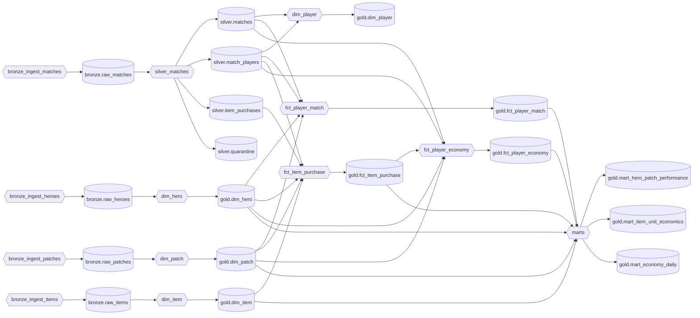

# Lineage

Generated from the code with `sbt "run lineage"`: each job declares the tables it reads and writes, so this diagram cannot drift from the implementation. Per-run, snapshot-level lineage is recorded in `ops.lineage`.

